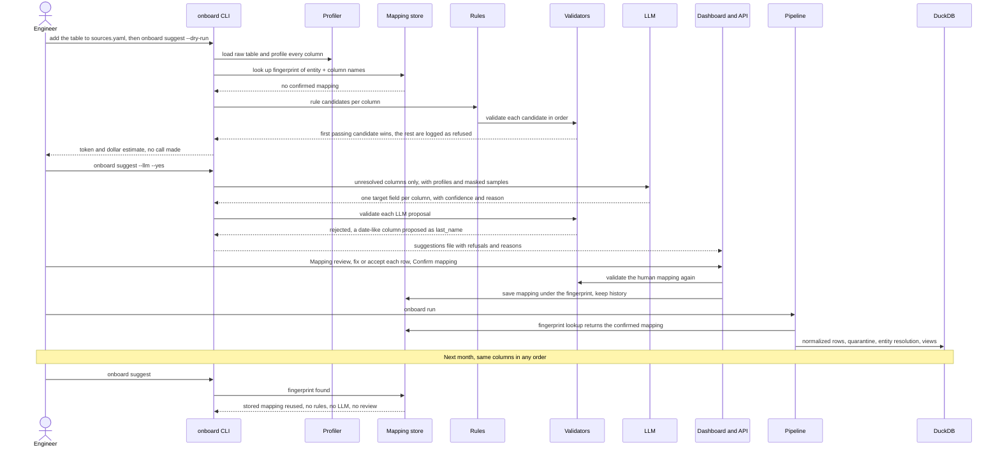
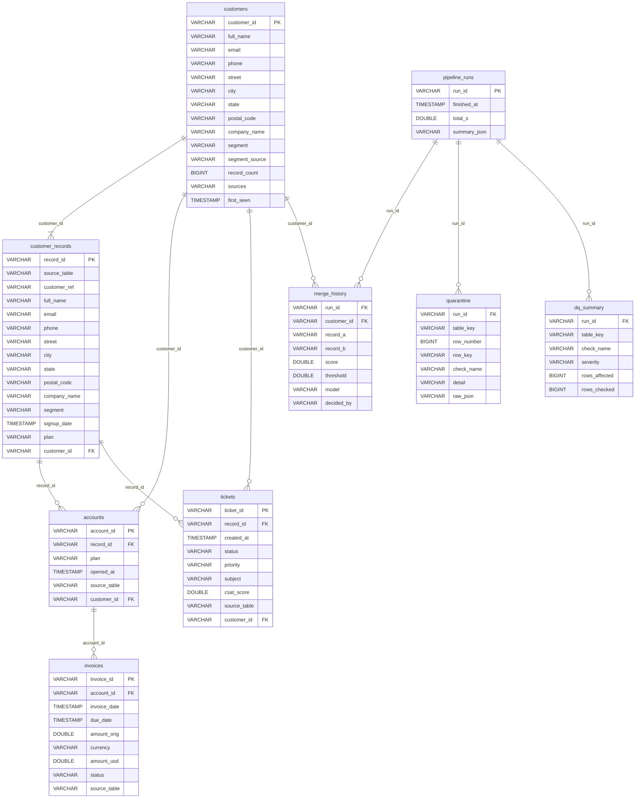
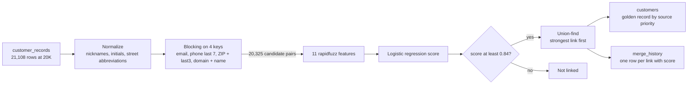

# data-onboarding

Turns a customer's messy CRM, billing and support exports into one clean, checked customer model, with a human approving every column mapping.

[](https://github.com/byteKumar/data-onboarding/actions/workflows/ci.yml)

**Status (2026-11-21).** Measured: rules-only mapping accuracy, entity-resolution precision and recall, pipeline runtime at about 20K and 200K customer records, and quarantine counts. All data is synthetic. Not measured yet: rules + LLM mapping accuracy (no paid LLM call has been made, spend is $0.00), the timed onboarding test for a new source, and the hand-labeled ground truth for that source. The demo video is not recorded yet.

## At a glance

- **What it does.** Reads a CRM CSV, a billing Excel file (two sheets) and a paginated support JSON API. It profiles every column, proposes a mapping onto one 28-field schema (rules first, an LLM for what rules miss, validators on every proposal), and a person confirms the mapping on a review screen. Then it cleans values, holds bad rows in a quarantine table with reasons, merges duplicate customers across systems, and serves a small dashboard.
- **The customer problem.** Week one of a data engagement: three systems describe the same customers with different column names, ID formats, date formats and currencies, and the same person appears several times. Nothing downstream is trustworthy until that is fixed.
- **Stack.** Python 3.12, pandas, DuckDB, rapidfuzz, scikit-learn, Anthropic SDK (optional), FastAPI, React 18 + Vite + TypeScript, pytest (47 tests), ruff, GitHub Actions, uv.
- **Entity resolution (held-out test split).** Precision **99.89%**, recall **97.20%** at threshold 0.84. Caveat: synthetic data is easier than real data, and blocking only compares about 95% of true pairs directly (clustering recovers some of the rest through shared matches).
- **Runtime and quarantine (one run each, Apple M3 laptop).** **2.42 s** for 21,209 generated customer records and **22.85 s** for 211,364. At ~20K, **952** of 67,359 input rows were quarantined, each with a reason.
- **Mapping accuracy, rules only.** 95.9% on the three known sources (optimistic: the same author wrote the rules and the column names) and **33.3%** on an unseen ERP export. The LLM step is built and tested offline but its accuracy is **not measured yet**.

## The problem

In the first week with a new customer, a Forward Deployed Engineer usually gets a pile of exports, not an API. In this project the pile is:

| System | Format | What disagrees |
|---|---|---|
| CRM | CSV, 8,939 contacts | `Full Name` with "Last, First" variants, `Phone #`, mixed date formats, a segment spelled many ways |
| Billing | Excel, 6,610 accounts and 39,365 invoices | `cust_no`, `bill_to_name`, `tel`, ZIP codes that lost their leading zero, USD/EUR/GBP with local number formats, day-first dates |
| Support | Paginated JSON API, 12,445 tickets | Nested fields like `requester.email`, some timestamps as epoch numbers, satisfaction scores outside 1 to 5 |

The same customer can appear in all three systems, with a nickname in one, a typo in another and a different email in the third. Until columns are mapped, values are normalized, bad rows are separated out and duplicates are merged, you cannot answer simple questions such as "revenue by segment" or "which accounts are at risk", because every answer double counts some customers and misses others.

## Why I built this

A Forward Deployed Engineer works directly with a customer's team and data to get a product working on their real systems. A large part of that job is the unglamorous start: getting data out of several systems into one model the customer trusts, explaining what was dropped and why, and asking the customer to make the decisions only they can make.

This project practices that part of the job:

- reading unfamiliar exports and profiling them before trusting them,
- using an LLM where it helps (the long tail of odd column names) while keeping a person and deterministic checks in control,
- keeping cost and data exposure low when calling a paid model,
- deduplicating customers and being able to explain every merge,
- measuring against a hidden ground truth and reporting failures as they are,
- writing for the customer as well as for engineers ([CUSTOMER_BRIEF.md](CUSTOMER_BRIEF.md) lists the decisions the customer must make).

It was built against a written spec in eight milestones, one commit each.

## Demo

Coming soon: a 3-minute demo video and screenshots of the Mapping review and Overview pages.

## Architecture

```mermaid
flowchart LR
    GEN["synth.py generator<br/>seed 42"]
    subgraph SRC["Customer exports"]
        CRM["CRM contacts<br/>CSV"]
        BILL["Billing accounts + invoices<br/>Excel"]
        SUP["Mock support API<br/>paginated JSON"]
    end
    CON["Connectors<br/>raw values, no type coercion"]
    PROF["Column profiling<br/>type, nulls, distinct, samples, pattern"]
    subgraph MAP["Mapping engine"]
        HIT{"Column set already<br/>confirmed?"}
        RULES["Rules<br/>synonyms, tokens, value patterns"]
        LLM["LLM for unresolved columns<br/>fake offline or Anthropic"]
        VAL["Validators<br/>entity, pattern, cardinality, uniqueness"]
        HUMAN["Human confirm screen<br/>dashboard Mapping review"]
        STORE[("Mapping store<br/>one JSON per fingerprint")]
    end
    NORM["Normalization<br/>names, emails, phones, ZIPs, dates, money to USD"]
    QC["Quality checks"]
    QUAR[("quarantine<br/>reason + raw row")]
    MODEL[("DuckDB unified model<br/>customer_records, accounts, invoices, tickets")]
    ER["Entity resolution<br/>blocking, rapidfuzz, logistic regression"]
    CUST[("customers + merge_history")]
    VIEWS["Analytics views<br/>revenue, open tickets, at risk"]
    API["FastAPI :8003"]
    UI["React dashboard :5173"]
    subgraph EVAL["Evaluation only"]
        GT[("Hidden ground truth")]
        EV["eval/ scripts"]
    end

    GEN --> SRC
    GEN -.-> GT
    CRM --> CON
    BILL --> CON
    SUP --> CON
    CON --> PROF --> HIT
    HIT -->|"no"| RULES --> VAL
    VAL -->|"unresolved"| LLM --> VAL
    VAL --> HUMAN --> STORE
    HIT -->|"yes, reuse"| STORE
    STORE -->|"confirmed mapping only"| NORM
    CON -->|"raw rows"| NORM
    NORM --> QC
    QC -->|"bad rows"| QUAR
    QC --> MODEL --> ER --> CUST
    MODEL --> VIEWS
    CUST --> VIEWS --> API --> UI
    GT -.-> EV
    MODEL -.-> EV
```



Two rules hold the design together:

1. **Nothing reaches the model without a confirmed mapping.** `pipeline.run` looks up each table's column fingerprint in the mapping store and stops with `MappingNotConfirmed` if there is none.
2. **Only `eval/` reads the ground truth.** `tests/test_no_ground_truth_leak.py` fails if any module in `src/onboard/` other than the generator mentions it.

The deeper walkthrough, module by module, is in [docs/ARCHITECTURE.md](docs/ARCHITECTURE.md).

## How a new source gets onboarded

There is no file-upload endpoint. A new export is registered by adding an entry to `sources.yaml` with its path and its entity (`customer`, `account`, `invoice` or `ticket`). The unseen ERP export in `eval/unseen_source.yaml` is the worked example.



The validator rejection shown above is a real one from the offline demo: with `LLM_PROVIDER=fake`, the stand-in model maps the CRM column `Last Activity` to `last_name`, and the validator refuses it because the column's values look like dates.

## System design

### Unified data model

All tables live in one DuckDB file (`data/onboard.duckdb` by default). They are created from pandas frames with `CREATE TABLE AS`, so the relationships below are not database constraints. They are enforced by the quality checks before anything is written. `merge_history` and `pipeline_runs` are appended on every run; every other table is replaced.



`record_id` is `<source>.<table>:<customer_ref>`, so IDs from two systems never collide. Four views sit on top: `account_facts`, `revenue_by_segment`, `open_tickets_by_account` and `at_risk` (`src/onboard/analytics.py`).

### Mapping engine

The target is a fixed schema of 28 fields plus `ignore` (`src/onboard/schema.py`). Each field lists the entities it may appear in and the profiled pattern classes it accepts.

**Order of work for one table** (`src/onboard/mapping/engine.py`):

1. **Mapping store.** If a human already confirmed a mapping for exactly this column set, it is reused for every column (confidence 1.0, method `store`). Nothing else runs.
2. **Rules** (`rules.py`). For each column, candidates come in this order: exact synonym of the normalized name (0.95), synonym after dropping qualifiers like "billing" or "requester" (0.85), name tokens (0.45 to 0.75), then value pattern (email 0.6, phone 0.55). Placeholders resolve per entity: `id` in a ticket table means `ticket_ref`, `created` in a customer table means `signup_date`. The first candidate that passes the validators wins.
3. **One column per field.** If two columns claim the same field, the higher confidence keeps it and the other is un-mapped with the reason logged.
4. **LLM** (`llm.py`), only with `--llm`. Only still-unresolved columns are sent, with the list of fields not yet taken. Each proposal goes through the same validators plus a conflict check against fields already mapped.
5. **Human confirm.** The dashboard shows each column's profile, proposed field, confidence, source (rule, LLM or stored) and any refusals. LLM rows always start unaccepted. On submit, the API validates the human's choices again and saves them only if all pass.

**What validators check** (`validators.py`): the field exists; it belongs to this table's entity; the column's pattern class is one the field accepts (an email column cannot become a date); category fields are under a distinct-value limit (for example `state` at most 80); key fields like `invoice_ref` are at least 95% distinct. `ignore` always passes.

**Mapping store** (`store.py`): one JSON file per fingerprint, where the fingerprint is the first 16 hex characters of SHA-256 over the entity and the sorted, stripped column names. Column order does not matter. A renamed or added column changes the fingerprint and sends the table back to review. Re-confirming keeps the previous mapping in `history`.

### Entity resolution



- **Blocking** (`er.py`): records are compared only if they share exact email, the last 7 phone digits, ZIP plus the first 3 letters of the last name, or email domain plus last-name prefix and first initial. Blocks larger than 100 records are skipped and counted. At ~20K this gives 20,325 pairs instead of about 222 million.
- **Features**: name similarity (token sort), email similarity, phone equal, street similarity (token set), ZIP equal, company similarity, each with a "missing" flag (name has none). 11 features in all.
- **Model**: scikit-learn logistic regression trained on train-split pairs by `eval/er_eval.py`. Coefficients, intercept and threshold are saved to `config/er_model.json`; the pipeline scores with plain NumPy.
- **Threshold**: swept from 0.05 to 0.99 on the validation split only, picking the highest pairwise F1 after clustering (ties go to the higher threshold). 0.82, 0.83 and 0.84 tied at F1 0.981, so 0.84 was chosen.
- **Clustering**: union-find over linked pairs, strongest first. Connected components become customers. Each union is written to `merge_history` with both record IDs, score, threshold, model and run ID.
- **Golden record**: for each field, the first non-null value in source priority CRM, then billing, then support. Missing segment falls back to the billing plan (`segment_source = 'plan_rule'`).

### Data-quality checks and quarantine

Rows that fail a check are moved to `quarantine` with the check name, a readable detail and the original row as JSON. Values that are unusable on their own (an email of `n/a`) are set to null and counted as "fixed", and the row stays.

| Check | Detail | Rows at ~20K |
|---|---|---|
| referential | account_ref not found in any accounts table | 215 |
| missing_required | amount is empty or unparseable | 188 |
| out_of_range | csat_score must be 1..5 | 131 |
| out_of_range | amount must be > 0 and <= 1,000,000 USD | 121 |
| invalid | due_date before invoice_date | 113 |
| missing_required | neither name nor email | 82 |
| duplicate_key | invoice_ref seen earlier | 67 |
| missing_required | ticket_created_at is empty or unparseable | 35 |
| | **Total** | **952** |

Other checks exist in `src/onboard/model.py` but quarantined no rows in this run: empty `customer_ref`, `account_ref`, `invoice_ref`, `invoice_date` or `ticket_ref`; duplicate `customer_ref`, `account_ref` or `ticket_ref`; dates outside 2000 to one year after the as-of date; and ticket requesters with neither name nor email. Separately, 75 CRM emails were set to null and the rows were kept.

### Key design decisions

| Decision | Alternative considered | Trade-off |
|---|---|---|
| Rules before the LLM | Send every column to the LLM | Rules are free, deterministic and explainable, but only as good as their vocabulary. The LLM only sees the long tail. |
| Validators on every proposal, including the human's | Trust the LLM's confidence | Cheap and catches impossible mappings, but a wrong pattern class blocks a correct mapping (see `subject` and `KUNNR` below). |
| Pipeline refuses unconfirmed tables | Load with a best-guess mapping | No silent bad data. Costs one review per new column set. |
| Fingerprint of the whole column set | Reuse confirmed mappings column by column | Simple and safe. One renamed column forces a full review. |
| Connectors keep raw values (object dtype) | Let pandas infer types | The profiler sees `02139` and mixed dates as sent. Every field needs explicit parsing later. |
| Date format inferred per column | Parse each value on its own | `03/05/2024` is read the same way as the rest of its column. A column mixing two conventions loses some values. |
| DuckDB file | Postgres (allowed by the spec) | No server, fast analytics, one file to share. Single writer, no concurrent loads. |
| Logistic regression on 11 features | Hand-set weights or a larger model | Trained, inspectable coefficients and a tuned threshold. Limited by what the features capture. |
| Union-find connected components | Correlation clustering or a cluster-size cap | Simple and fast. Can chain A to B to C and over-merge. |
| Quarantine the whole row | Null the bad value and keep the row | Clear and conservative. A ticket with CSAT 10 disappears from open-ticket counts. |
| Fixed FX rates (EUR 1.08, GBP 1.27) and a fixed as-of date (2025-06-30) | Live FX feed and today's date | Reproducible runs. Not financially exact. |
| Rule-based "at risk" (2 of 4 rules) | A churn model | A customer success lead can read and argue with each rule. Less clever. |

### Privacy

- The LLM receives the table name, the entity, the column name and its profile (pattern, dtype, null rate, distinct count) and up to 3 sample values per **unresolved** column. Columns the rules or the store already mapped are never sent.
- Samples from columns profiled as email or phone are replaced by their shape (letters become `a` or `A`, digits become `9`, so an email shows up as something like `aaaaaa@aaaa.aaa`). Other samples are cut to 40 characters but **not** masked, so an unresolved name or street column would send up to 3 real values. `tests/test_mapping_llm.py` checks that raw emails never appear in the prompt.
- Full records never leave the machine. The default provider is `none`.

### Cost control

- `LLM_PROVIDER` defaults to `none`. `fake` is an offline stand-in for demos and tests. `anthropic` is the only paid option.
- The paid client refuses to run unless the CLI passes `--yes`. `--dry-run` prints a token and dollar estimate (about 4 characters per token, prices set in `src/onboard/config.py`) and makes no call.
- Rules resolve 39 of 49 columns on the known sources, so only 10 columns would go to the LLM. The dry run on fresh seed-42 data estimates about 2,098 input and 680 output tokens, about $0.00055 for all four tables.
- Confirmed tables are never re-sent: the store answers first.
- Tests strip every `ANTHROPIC_*` variable and force `LLM_PROVIDER=none`; CI sets `LLM_PROVIDER: none`. Total API spend so far: $0.00.

### What changes at 10x and 100x

- **10x (~200K customer records): measured.** 22.85 s end to end on a laptop. Entity resolution is a third of that (7.66 s), and candidate pairs grow about 35x for 10x records because blocks get more name collisions. One block hit the 100-record cap and was skipped.
- **100x (~2M): not measured.** From reading the code, the pressure points would be: everything is in-memory pandas with per-value Python parsing; candidate pairs grow faster than records and more blocks hit the cap, which costs recall; the union-find loop runs in Python; and every run rebuilds every table. Likely changes: push parsing into DuckDB SQL, resolve only new or changed records against existing customers, use more selective blocking keys, and move to a multi-writer database if several loads must run at once.
- **More sources, not more rows.** LLM cost scales with new column sets, not with rows. Per-column mapping reuse would cut review time when exports change slightly.

## Evaluation and results

**Method.** The generator (`src/onboard/synth.py`, seed 42) writes the raw exports and, separately, a hidden ground truth: the correct field for every column and the true customer for every record. Only `eval/` reads it. Entity-resolution records are split by true customer (MD5 of the true ID): 60% train, 20% validation, 20% test, so no customer's records sit in two splits. The model is fit on train, the threshold is chosen on validation, and test is scored once. Every number below comes from a single run, reported as is, with no best-of. Full details and raw outputs: [RESULTS.md](RESULTS.md) and `eval/results/*.json`.

**Machine:** Apple M3, 16 GB RAM, macOS 26.6.2, Python 3.12.16. **Date:** 2026-11-21.

### Mapping accuracy, rules only

Command: `uv run python eval/mapping_eval.py --mode rules` (add `--unseen` for the ERP source). A column is correct when the final target equals the ground truth; a column the rules leave unresolved counts as `ignore`.

| Sources | Columns | Correct | Accuracy | Resolved by rules | Correct when resolved | Unresolved (truth = ignore) |
|---|---|---|---|---|---|---|
| CRM + billing (2 sheets) + support | 49 | 47 | **95.9%** | 39 | 39/39 | 10 (8) |
| Unseen ERP export, vs generator truth | 15 | 5 | **33.3%** | 3 | 2/3 | 12 (3) |

Caveats:

- **95.9% is optimistic.** The same author wrote the generator's column names and the rule synonyms. The unseen source (33.3%) is the honest number for "rules on a new export".
- **Known miss 1: `subject`.** The rule proposed `subject`, but the support subjects are 14 templated strings, so the profiler classes the column as `category` and the `subject` field only accepts `text`. The validator refused a correct mapping.
- **Known miss 2: `KUNNR`.** The ERP customer number is a 10-digit zero-padded number, which matches the phone regex. It was mapped to `phone`, which then pushed the real phone column `TELF1` out under the one-column-per-field rule.
- Rules + LLM accuracy, LLM validator rejections and API spend: **not measured yet**.

### Entity resolution

Command: `uv run python eval/er_eval.py`. Metrics are pairwise after clustering.

| Split | Records | True pairs | Blocking recall | Precision | Recall | F1 |
|---|---|---|---|---|---|---|
| Validation | 4,299 | 2,884 | 94.73% | **99.78%** | **96.46%** | 98.10% |
| Test | 4,132 | 2,826 | 95.36% | **99.89%** | **97.20%** | 98.53% |
| All records (includes train, reference only) | 21,108 | 14,372 | - | 99.26% | 96.73% | 97.98% |

Threshold 0.84. Pairs that span two splits (3,707, all non-matches by construction) are excluded from the split rows; the model would wrongly link 23 of them, which is why all-records precision is lower. Blocking compares only about 95% of true pairs directly. Recall can still go above that, because union-find clustering links two records that each match a third record, even when the pair itself was never compared. Synthetic matching is easier than real data, even with household hard negatives in the generator.

### Runtime

Command: `uv run python scripts/benchmark.py --scales 1 10`. One run per scale. Generation is excluded. Pipeline = load + normalize + checks + model + entity resolution + DuckDB write.

| Scale | Customer records generated | Invoices | Tickets | Pipeline total | Entity resolution | Candidate pairs |
|---|---|---|---|---|---|---|
| 1 (~20K) | 21,209 | 39,365 | 12,445 | **2.42 s** | 0.48 s | 20,325 |
| 10 (~200K) | 211,364 | 393,557 | 126,116 | **22.85 s** | 7.66 s | 711,854 |

Quarantine: 952 rows at ~20K (table above) and 9,453 at ~200K, same reasons.

### Not measured yet

- Rules + LLM mapping accuracy and LLM validator rejections (needs the paid call).
- Onboarding time for the unseen source, by hand versus with the tool (protocol in [eval/ONBOARDING_TIMING.md](eval/ONBOARDING_TIMING.md)).
- Hand-labeled ground truth for the unseen source, and accuracy against it.
- Demo video.

## Getting started

### Prerequisites

- macOS or Linux
- [uv](https://docs.astral.sh/uv/) (installs Python 3.12 from `.python-version`)
- Node.js 24 and npm (for the dashboard)
- No Docker and no database server. No API key for the offline path.

### Offline quickstart (fake LLM, no key, no cost)

```bash
git clone https://github.com/byteKumar/data-onboarding.git
cd data-onboarding
uv sync

uv run onboard generate                          # seed 42: raw exports, unseen ERP export, hidden ground truth in data/
uv run onboard profile                           # optional: see each column's pattern, nulls, samples
LLM_PROVIDER=fake uv run onboard suggest --llm   # rules + offline stand-in LLM, writes data/suggestions/
```

Start the API and the dashboard in two terminals:

```bash
uv run uvicorn onboard.api:app --port 8003
cd dashboard && npm install && npm run dev       # http://localhost:5173
```

Confirm the mappings, then run the pipeline. Pick one way to confirm:

- **Dashboard:** open **Mapping review**, check each row, fix or accept it, then **Confirm mapping**. Note: the validators will not let you confirm `subject` as `subject` (see the known misses), so choose `ignore` for it.
- **CLI:** `uv run onboard accept` saves the current suggestions as they are. With the fake LLM this includes its mistakes.
- **Simulated human:** `uv run python eval/seed_confirmed_mappings.py` writes the ground-truth mapping, stamped `simulated-human (ground truth)`. This is how the measured numbers were produced.

```bash
uv run onboard mappings        # list confirmed mappings
uv run onboard run             # pipeline -> data/onboard.duckdb
```

Then reload the dashboard's **Overview** tab.

The fake LLM's output is not a measurement. It fuzzy-matches names on purpose so the validators have something to reject.

### Real LLM mode (paid, opt-in)

```bash
cp .env.example .env              # set LLM_PROVIDER=anthropic and your key; never commit .env
set -a; source .env; set +a

uv run onboard suggest --dry-run      # prints the token and dollar estimate, makes no call
uv run onboard suggest --llm --yes    # makes the call, prints spend from response.usage
```

The model is `LLM_MODEL` (default `claude-haiku-5-5`). Tables that already have a confirmed mapping cost nothing: the store answers first. To measure rules + LLM accuracy: `LLM_PROVIDER=anthropic uv run python eval/mapping_eval.py --mode llm` prints the estimate, then add `--yes`.

### Tests and lint

```bash
uv run pytest -q              # 47 tests, no network, no paid calls
uv run ruff check .
cd dashboard && npm run build
```

CI (`.github/workflows/ci.yml`) runs the same three steps on every push and pull request.

### Benchmarks and evaluations

These overwrite files in `eval/results/` (and `er_eval.py` also rewrites `config/er_model.json`). The committed files are the reported runs.

```bash
uv run python eval/mapping_eval.py --mode rules            # needs data/ground_truth from `onboard generate`
uv run python eval/mapping_eval.py --mode rules --unseen
uv run python eval/er_eval.py                              # needs confirmed mappings
uv run python scripts/benchmark.py --scales 1 10           # needs confirmed mappings, generates into data/bench/
```

### Ports and settings

| What | Where |
|---|---|
| FastAPI backend | `http://localhost:8003` (`/api/...`; the mock support API is also mounted at `/mock/support`) |
| React dashboard (Vite dev server, proxies `/api` to 8003) | `http://localhost:5173` |
| Mock support API on its own (optional) | `uv run uvicorn onboard.mock_api:app --port 8004` |
| Environment variables | `LLM_PROVIDER` (`none`, `fake`, `anthropic`), `LLM_MODEL`, `ANTHROPIC_API_KEY`, `ONBOARD_HOME` (project root), `ONBOARD_DB` (DuckDB path) |

## Project layout

```
data-onboarding/
├── sources.yaml                 # the customer's exports: one entry per table, with its entity
├── config/er_model.json         # trained entity-resolution model + tuned threshold (written by eval/er_eval.py)
├── src/onboard/
│   ├── cli.py                   # `onboard` commands: generate, profile, suggest, accept, run, mappings
│   ├── config.py                # paths, FX rates, LLM prices, as-of date, env settings
│   ├── synth.py                 # synthetic exports + hidden ground truth (the only src module that writes it)
│   ├── mock_api.py              # paginated support-ticket JSON API
│   ├── connectors.py            # CSV, Excel and JSON API loaders, raw values only
│   ├── parsing.py               # regexes, date, money, phone, email, ZIP parsing
│   ├── profiling.py             # per-column profile and pattern class
│   ├── schema.py                # the 28 target fields and what each accepts
│   ├── mapping/
│   │   ├── rules.py             # synonyms, token rules, pattern rules
│   │   ├── validators.py        # rejects impossible mappings
│   │   ├── llm.py               # FakeLLM, AnthropicLLM, prompt, JSON schema, cost estimate
│   │   ├── engine.py            # store -> rules -> conflicts -> LLM, with validators
│   │   └── store.py             # confirmed mappings keyed by fingerprint
│   ├── service.py               # profile -> suggest -> confirm glue for CLI and API
│   ├── transform.py             # apply a mapping, normalize values, convert money to USD
│   ├── quality.py               # quarantine and "fixed" bookkeeping
│   ├── model.py                 # builds customer_records, accounts, invoices, tickets with checks
│   ├── er.py                    # blocking, features, scoring, union-find, golden record
│   ├── pipeline.py              # end-to-end run into DuckDB
│   ├── analytics.py             # DuckDB views and the four at-risk rules
│   └── api.py                   # FastAPI: mapping review/confirm + metrics
├── dashboard/                   # React + Vite + TypeScript: Overview and Mapping review pages
├── eval/
│   ├── mapping_eval.py          # mapping accuracy vs ground truth
│   ├── er_eval.py               # train, tune, test entity resolution
│   ├── seed_confirmed_mappings.py  # simulated human confirm from ground truth
│   ├── unseen_source.yaml       # the 4th, unseen ERP source
│   ├── public_source.yaml       # optional public ticket dataset
│   ├── ONBOARDING_TIMING.md     # protocol for the timed onboarding test
│   └── results/                 # measured outputs (JSON, with command, time and machine)
├── scripts/
│   ├── benchmark.py             # runtime at scale 1 and 10
│   └── fetch_public_tickets.py  # optional public dataset download
├── tests/                       # pytest suite (47 tests)
├── docs/
│   ├── ARCHITECTURE.md          # deep dive for study
│   └── INTERVIEW_NOTES.md       # per-milestone notes and exercises
├── RESULTS.md                   # all measured numbers
├── CUSTOMER_BRIEF.md            # write-up for the customer's operations lead
└── data/                        # generated, gitignored: raw/, unseen/, ground_truth*/, suggestions/, mapping_store/, onboard.duckdb
```

## Limitations and roadmap

**Limitations**

- All data is synthetic. Real data will have problems the generator does not simulate; expect lower matching accuracy until it is re-measured on real records.
- The LLM step is built and unit-tested with a stub client, but no paid call has been made, so its accuracy is unknown.
- The phone regex accepts any 10-digit number, so an ID like `KUNNR` is profiled as a phone.
- Validators also run on the human's choices and cannot be overridden. Two correct mappings (`subject` to `subject`, `KUNNR` to `customer_ref`) cannot be confirmed through the dashboard today; only the simulated-human script, which writes to the store directly, gets them in.
- Mapping reuse is all-or-nothing per column set.
- No upload endpoint: new sources are added in `sources.yaml`.
- About 5% of true duplicate pairs are never compared because they share no blocking key. Connected components can over-merge by chaining.
- Merges cannot be undone from the UI. `merge_history` explains each one, but an unmerge is a manual step.
- Unmasked samples of unresolved non-email, non-phone columns can reach the LLM (up to 3 values, 40 characters each).
- The API has no authentication and is meant for local use.

**Roadmap (not built yet)**

1. Run the paid rules + LLM evaluation and report accuracy, rejections and spend.
2. Run the timed onboarding test and the hand-labeling protocol in `eval/ONBOARDING_TIMING.md`.
3. Record the demo video.
4. Fix the phone pattern for zero-padded IDs, add a test, and report the before and after numbers separately.
5. Let a human override a validator with a recorded reason.
6. Per-column mapping reuse.
7. A merge review screen with unmerge.
8. Incremental entity resolution for new records only.

## Study guide

Read in this order:

1. [CUSTOMER_BRIEF.md](CUSTOMER_BRIEF.md) and [RESULTS.md](RESULTS.md): what the customer gets and what was measured.
2. `sources.yaml` and `src/onboard/schema.py`: the inputs and the target.
3. `src/onboard/synth.py` (skim), `connectors.py`, `parsing.py`, `profiling.py`: how raw data arrives and gets described.
4. `src/onboard/mapping/rules.py`, `validators.py`, `engine.py`, `llm.py`, `store.py`, then `service.py`: the mapping engine.
5. `src/onboard/transform.py`, `quality.py`, `model.py`, `pipeline.py`: cleaning, checks and the model.
6. `src/onboard/er.py`, then `eval/er_eval.py`: entity resolution and how it was tuned.
7. `src/onboard/analytics.py`, `api.py`, `dashboard/src/pages/Mapping.tsx`, `Overview.tsx`: what the user sees.
8. `eval/mapping_eval.py`, `scripts/benchmark.py`, `tests/`: how every number is produced and guarded.

Then work through [docs/INTERVIEW_NOTES.md](docs/INTERVIEW_NOTES.md) (one "explain or change it yourself" exercise per milestone) and [docs/ARCHITECTURE.md](docs/ARCHITECTURE.md).
