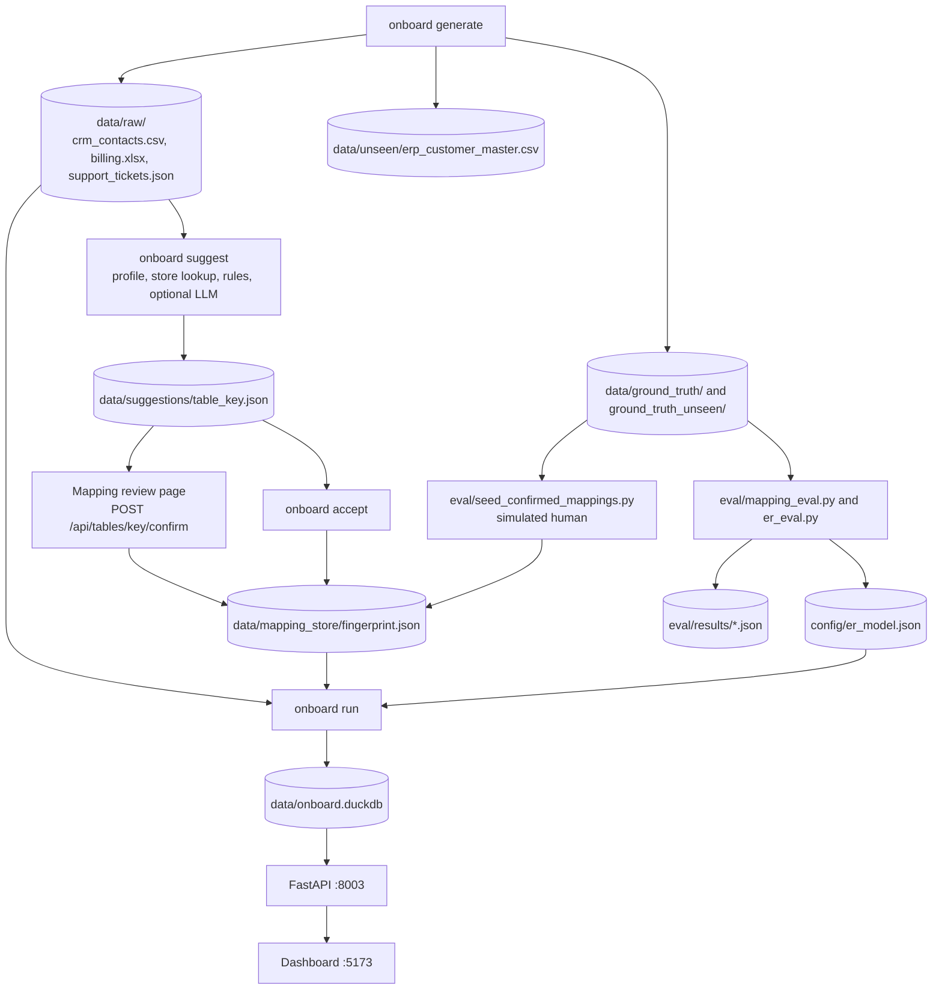
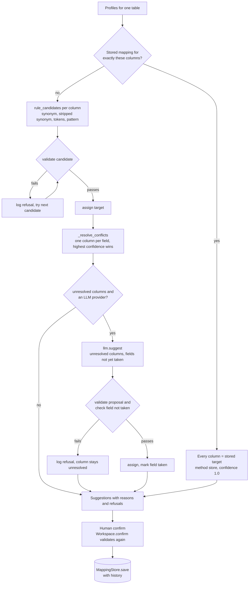
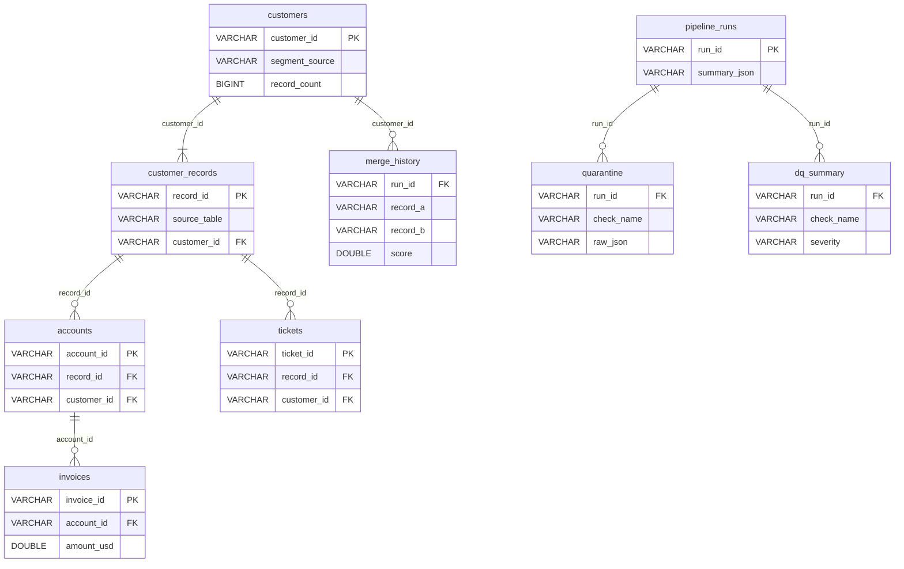
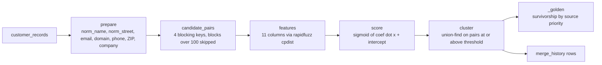

# Architecture

A study guide to how data-onboarding works, file by file. The [README](../README.md) has the short version and the measured results. Every function name, table, path and number here comes from the code and the committed results as of commit `2832dd6`.

Contents:

1. [Components and responsibilities](#1-components-and-responsibilities)
2. [Pipeline data flow, end to end](#2-pipeline-data-flow-end-to-end)
3. [Module walkthrough](#3-module-walkthrough)
4. [Profiling internals](#4-profiling-internals)
5. [Mapping engine internals](#5-mapping-engine-internals)
6. [The LLM call: prompt, schema, safety](#6-the-llm-call-prompt-schema-safety)
7. [Normalization, checks and the unified model](#7-normalization-checks-and-the-unified-model)
8. [Entity-resolution internals](#8-entity-resolution-internals)
9. [Analytics, API and dashboard](#9-analytics-api-and-dashboard)
10. [How each metric is computed](#10-how-each-metric-is-computed)
11. [Tests and CI](#11-tests-and-ci)
12. [Trade-offs and known failure modes](#12-trade-offs-and-known-failure-modes)

## 1. Components and responsibilities

| Component | Files | Responsible for | Not responsible for |
|---|---|---|---|
| Generator | `src/onboard/synth.py` | Synthetic CRM, billing and support exports, the unseen ERP export, and the hidden ground truth | Anything at pipeline run time |
| Connectors | `connectors.py`, `mock_api.py`, `sources.yaml` | Loading CSV, Excel sheets and a paginated JSON API as raw object-dtype DataFrames | Type conversion or cleaning |
| Profiler | `profiling.py`, `parsing.py` | One `ColumnProfile` per column: dtype, null rate, distinct count, samples, pattern class, shape, date format | Deciding the mapping |
| Mapping engine | `mapping/engine.py`, `rules.py`, `validators.py`, `llm.py`, `store.py`, `schema.py` | Proposing a target field per column, validating every proposal, storing confirmed mappings | Applying the mapping to data |
| Workspace service | `service.py` | Shared glue for CLI and API: profile, suggest, write suggestion files, confirm with validation | Business rules |
| Transform | `transform.py` | Applying a confirmed mapping and normalizing values field by field | Dropping rows |
| Quality and model | `quality.py`, `model.py` | Checks, quarantine, "fixed" counts, building `customer_records`, `accounts`, `invoices`, `tickets` | Deduplication |
| Entity resolution | `er.py`, `config/er_model.json` | Blocking, features, scoring, clustering, golden record, merge history | Training (that is `eval/er_eval.py`) |
| Pipeline | `pipeline.py` | Orchestrating one run, timing each stage, writing DuckDB | Asking for mappings |
| Analytics | `analytics.py` | DuckDB views and the four at-risk rules | Serving HTTP |
| API | `api.py` | Mapping review and confirm endpoints, metrics endpoints, mounting the mock API | Running the LLM (the CLI does that) |
| Dashboard | `dashboard/src/` | Overview page and Mapping review page | Any logic the API does not expose |
| CLI | `cli.py` | The `onboard` command | |
| Evaluation | `eval/`, `scripts/benchmark.py` | Everything that reads ground truth or writes `eval/results/` | Anything the pipeline needs at run time |

## 2. Pipeline data flow, end to end



Step by step, for `uv run onboard run` (`pipeline.run`):

1. **Load.** For each table in `sources.yaml`, `connectors.load_table` returns a raw DataFrame. Timed as `load:<table>`.
2. **Find the mapping.** `store.fingerprint(entity, column names)` is looked up in `data/mapping_store/`. No match raises `MappingNotConfirmed` and the run stops (CLI exit code 4).
3. **Normalize.** `transform.normalize_table(raw, mapping)` returns unified field names, cleaned values, the original row number `_row` and per-row soft issues `_issues`. Timed as `normalize:<table>`.
4. **Checks and model.** `model.build(frames, QualityLog())` builds customer and account records first, then invoices (which need known accounts), then tickets. Failing rows go to the quarantine list. Timed as `checks+model`.
5. **Entity resolution.** `er.resolve(customer_records, config/er_model.json, run_id)` adds `customer_id` to every record and returns `customers` and `merge_history`. The pipeline then joins `customer_id` onto `accounts` and `tickets` by `record_id`. Timed as `entity_resolution`. Skipped with `--no-er`.
6. **Write.** Every table is written with `CREATE OR REPLACE TABLE ... AS SELECT` from the DataFrame, except `merge_history` which is appended. Columns starting with `_` are dropped. Then `quarantine`, `dq_summary` and the analytics views. Timed as `write_duckdb`.
7. **Record the run.** A row is appended to `pipeline_runs` with the run ID (`YYYYmmddTHHMMSS-<6 hex>`), finish time, total seconds and the JSON summary that the CLI also prints.

## 3. Module walkthrough

### `src/onboard/cli.py`
The `onboard` command (registered in `pyproject.toml`).
- `cmd_generate`: calls `synth.generate(out, scale, seed)` and prints the summary.
- `cmd_profile`: prints each column's pattern, dtype, null rate, distinct count and two samples.
- `cmd_suggest`: rules only by default. With `--llm` or `--dry-run` it checks `LLM_PROVIDER`; for `anthropic` it prints a per-table and total estimate and returns without a call unless `--yes` was given. Then `Workspace.run_suggest` per table, and prints spend from `response.usage`.
- `cmd_accept`: saves the current suggestions as the confirmed mapping (`confirmed_by` from `--by`, default `cli`).
- `cmd_run`: runs the pipeline; `--db` and `--no-er` options.
- `cmd_mappings`: lists the store.

### `src/onboard/config.py`
`FX_TO_USD` (USD 1.0, EUR 1.08, GBP 1.27), `DEFAULT_LLM_MODEL` (`claude-haiku-5-5`), `LLM_PRICE_IN_PER_M` and `LLM_PRICE_OUT_PER_M` (used only for estimates and spend reporting), `AS_OF_DATE` (`2025-06-30`), `PLAN_SEGMENT` (plan code to segment fallback). `Settings` resolves every path from the project root, which `ONBOARD_HOME` can override; `ONBOARD_DB` overrides the DuckDB path. `llm_provider()` defaults to `none`.

### `src/onboard/synth.py`
`generate(out_dir, scale=1.0, seed=42, unseen=True)` creates `int(10_300 * scale)` true customers (`_make_entities`) and renders them through `_crm`, `_billing` and `_support`, each with its own column names (`CRM_MAP`, `ACCOUNTS_MAP`, `INVOICES_MAP`, `TICKETS_MAP`) and its own messiness: `messy_name`, `messy_email`, `messy_phone`, `messy_street`, `_fmt_amount`. Households (different people sharing an address and last name) are hard negatives for entity resolution. `generate_unseen` writes the ERP export (`ERP_MAP`, SAP-style names) for about 30% of customers, on its own random stream (`seed + 7919`) so adding it does not change the other three sources. Ground truth: `column_mapping.csv` (source, table, column, target_field), `clusters.csv` (record_id, true_customer_id), `summary.json`. At seed 42, scale 1: 10,712 true customers, 21,209 customer records, 39,365 invoices, 12,445 tickets, 3,204 ERP rows.

### `src/onboard/mock_api.py`
`create_mock_app(data_path)` serves `GET /tickets?page=&page_size=` (default 1000, max 5000) and returns `{data, page, next_page, total}`. It is mounted in the main API at `/mock/support` and can run alone on port 8004.

### `src/onboard/connectors.py`
- `TableSpec`: one table from the manifest (`source`, `name`, `kind`, `entity`, `path`, `sheet`, `url`, `endpoint`); `key` is `source.name`.
- `load_manifest(path)`: parses `sources.yaml`.
- `read_csv`: `dtype=object`, only empty strings become null.
- `read_excel`: calamine engine, `dtype=object`. Excel integers and date cells come through as Python numbers and datetimes.
- `fetch_json_api(base_url, endpoint, data_path, page_size=2000)`: follows `next_page` until it is null. `base_url="inproc"` uses FastAPI's `TestClient` against the mock app, so no server is needed. `_flatten` uses `pd.json_normalize(sep=".")` (giving `requester.email`) and joins list values with commas (`tags`).
- `load_table(spec, root)`: dispatch on `kind`.

### `src/onboard/parsing.py`
Regexes shared by profiling and transform: `EMAIL_RE`, `PHONE_RE`, `ZIP_RE`, `NUM_RE`, `MONEY_RE`, `MONEY_MARK_RE`, `ID_RE`. Helpers:
- `to_str`: canonical string; integral floats lose `.0` (Excel ints).
- `try_parse_date(v, fmt)`: datetimes pass through; numbers between 2000-01-01 and 2033 are epoch seconds; strings try the column format first, then 12 known formats; years outside 1990 to 2035 are rejected.
- `infer_date_format(values)`: the one format that parses the most of the first 500 string values.
- `parse_date_series`: infers once per column, then parses every value.
- `parse_money`: currency from symbol or code; whichever of `,` and `.` comes last is the decimal mark; a lone comma followed by exactly two digits is a decimal comma.
- `normalize_phone` (10 digits, leading US `1` removed), `normalize_email` (lowercase, must match the regex), `normalize_zip` (first 5 digits, zero-padded).

### `src/onboard/profiling.py`
`profile_column(name, series)` and `profile_table(df)`. See section 4.

### `src/onboard/schema.py`
`TargetField(name, entities, patterns, description, max_distinct, min_distinct_ratio)` and the 28-entry `FIELDS` dict, plus `IGNORE = "ignore"` and `fields_for_entity(entity)`. Entities: `customer`, `account`, `invoice`, `ticket`.

### `src/onboard/mapping/`
- `rules.py`: `normalize(col)` (splits camelCase and letter-digit boundaries, `#` becomes `no`, lowercases), `SYNONYMS`, `QUALIFIERS`, `TOKEN_RULES`, `PATTERN_RULES`, `rule_candidates(col, profile, entity)`.
- `validators.py`: `validate(target, profile, entity)` returns `None` or a readable reason.
- `engine.py`: `Suggestion`, `MappingResult` (`mapping()`, `stats()`), `suggest(entity, profiles, llm, stored, table_key)`, `_resolve_conflicts`.
- `llm.py`: `MappingLLM` protocol, `FakeLLM`, `AnthropicLLM`, `build_prompt`, `response_schema`, `estimate`, `cost_usd`, `get_llm`, `PaidCallNotConfirmed`, `LLMError`.
- `store.py`: `fingerprint(entity, columns)` and `MappingStore` (`get`, `get_mapping`, `save`, `all`).

### `src/onboard/service.py`
`Workspace` caches profiles per table and offers `rules_only`, `llm_estimate` (zero if the fingerprint is already confirmed), `run_suggest` (writes `data/suggestions/<table_key>.json` with profiles, suggestions, stats, LLM usage and `confirmed`), `load_suggestions` (reuses the file only if its fingerprint still matches the data), and `confirm(spec, mapping, confirmed_by)`. `confirm` refuses to save if any column is missing or unknown, any choice fails `validate`, or two columns claim the same field.

### `src/onboard/transform.py`
`normalize_table(raw, mapping)`: per field, reference IDs stay strings; names go through `clean_name` ("Last, First" flipped, all-caps title-cased); emails, phones, ZIPs, dates and amounts are parsed, and a non-empty value that fails parsing is nulled and recorded as a soft issue (`invalid_email`, `invalid_phone`, `invalid_postal_code`, `unparseable_<date field>`, `unparseable_amount`). `canon_segment` maps spellings to Enterprise, Mid-Market or SMB; `canon_invoice_status` maps to paid, unpaid, overdue or void. Currency comes from the currency column, else the amount's symbol, else USD; `amount_usd` uses `FX_TO_USD`. If only first and last name were mapped, `full_name` is built from them.

### `src/onboard/quality.py`
`QualityLog.hold(table_key, df, raw, mask, check, detail, key_col)` moves masked rows to the quarantine list (with `raw_json` of the original row) and records a summary line. `soft_issues` counts the `_issues` lists as severity `fixed (set to null)`. `frames(run_id)` returns the `quarantine` and `dq_summary` DataFrames. Constants: dates must fall between 2000-01-01 and as-of plus 366 days; invoices at most 1,000,000 USD.

### `src/onboard/model.py`
`build(frames, log)`: see section 7. `_records` projects any customer-like table onto `RECORD_COLS`.

### `src/onboard/er.py`
`norm_name`, `norm_street`, `prepare`, `_block`, `candidate_pairs`, `features`, `load_model`, `score`, `_UF`, `cluster`, `customer_id_for`, `_golden`, `resolve`. See section 8.

### `src/onboard/pipeline.py`
`run(settings, manifest, db_path, run_er)` and `MappingNotConfirmed`. See section 2.

### `src/onboard/analytics.py`
`RISK_RULES`, `RISK_MIN_RULES = 2`, the `VIEWS` SQL and `create_views(con)`. See section 9.

### `src/onboard/api.py`
FastAPI app with CORS for `localhost:5173`. `set_workspace` lets tests point it at a temporary project. Endpoints in section 9.

### `dashboard/`
React 18 + Vite + TypeScript, no chart library. `App.tsx` switches between two pages. `api.ts` holds the typed fetch helpers. `pages/Mapping.tsx` is the confirm screen; `pages/Overview.tsx` shows KPIs, revenue bars, open tickets, at-risk accounts and the data-quality panel. `vite.config.ts` proxies `/api` to port 8003.

### `eval/` and `scripts/`
- `eval_common.py`: `truth_mapping`, `machine`, `save` (adds `measured_at` and `machine` to every results file).
- `mapping_eval.py`: mapping accuracy (section 10).
- `er_eval.py`: train, tune and test entity resolution (sections 8 and 10).
- `seed_confirmed_mappings.py`: writes the ground-truth mapping into the store, stamped `simulated-human (ground truth)`. It calls `MappingStore.save` directly, so validators do not run.
- `scripts/benchmark.py`: generates each scale into `data/bench/scale_<n>/`, copies the confirmed mappings and the ER model, times one `pipeline.run`.
- `scripts/fetch_public_tickets.py`: optional download of a public ticket dataset into `data/public/` (licence not verified; read the dataset card first).

## 4. Profiling internals

`profile_column` works on the non-null values. Null rate and distinct count use the whole column. Pattern classification uses up to 5,000 values (a fixed random sample when there are more). `samples` are the first 5 distinct values; `shape` is the most common value shape (digits as `9`, letters as `a` or `A`).

`classify` checks pattern classes in a fixed order and returns the first that passes:

| Order | Class | Rule |
|---|---|---|
| 1 | email | at least 80% match `EMAIL_RE` |
| 2 | date | at least 80% parse with the inferred column format, and at least half are not bare numbers |
| 3 | currency | at least 30% carry a currency mark and at least 90% look like money |
| 4 | phone | at least 80% match `PHONE_RE` |
| 5 | zip | at least 90% match `ZIP_RE` |
| 6 | id, category or number | at least 90% numeric: `id` if integral and at least 90% distinct, `category` if 20 or fewer distinct, else `number` |
| 7 | id | at least 90% look like an ID and at least 30% distinct |
| 8 | category | 50 or fewer distinct, or very low distinct ratio with short values |
| 9 | text | everything else |

The order explains both known mapping failures. A 10-digit zero-padded customer number reaches step 4 before step 6, and `PHONE_RE` accepts any 10 digits, so it becomes `phone`. Support subjects are 14 templated strings, so they reach step 8 and become `category`.

## 5. Mapping engine internals



**Rule candidates** (`rule_candidates`), in the order they are tried:

| Tier | Method | Confidence | Example |
|---|---|---|---|
| Exact synonym of the normalized name | `rule:synonym` | 0.95 | `E-mail Address` normalizes to `e mail address` |
| Synonym after dropping qualifiers (`requester`, `billing`, `mailing`, ...) | `rule:synonym` | 0.85 | |
| Name contains tokens | `rule:token` | 0.45 to 0.75 | `satisfaction_rating.score` contains `satisfaction` |
| Value pattern | `rule:pattern` | email 0.6, phone 0.55 | `SMTP_ADDR` values are emails |

Duplicate targets within one column's list are dropped, so each target is tried once. Placeholders `@ref`, `@date` and `@status` resolve by entity (`PRIMARY_REF`, `ENTITY_DATE`, `ENTITY_STATUS`), and a target that does not belong to the entity is skipped.

**Validators** (`validate`), in order: `ignore` passes; unknown field; field not allowed for this entity; empty column passes; pattern class not in the field's accepted patterns; more distinct values than `max_distinct`; distinct ratio below `min_distinct_ratio`. They only read the profile, so they are cheap and deterministic.

**Conflicts.** After rules, if several columns hold the same field, the highest confidence keeps it and the others are reset with a refusal like `conflict: 'requester.name' is a stronger match`. LLM proposals are checked against a `taken` map instead, and the first accepted proposal for a field claims it.

**Stats** (`MappingResult.stats`): columns, resolved by store, rules and LLM, unresolved, and rule and LLM proposals rejected. An LLM `ignore` counts as resolved by the LLM.

**Store and fingerprint.** `fingerprint` is the first 16 hex characters of SHA-256 over `entity + "\n" + sorted(stripped column names)`. `suggest` only reuses a stored mapping if its column set equals the table's column set exactly. `save` keeps the previous mapping, author and time in `history`.

**Confirm screen** (`dashboard/src/pages/Mapping.tsx`). Columns: source column, profile (pattern, null %, distinct count, 3 samples), proposed field (a dropdown of fields allowed for the entity, plus `ignore`), confidence, source pill (`rule`, `LLM`, `stored`, `none`), validator status with refusals, and an Accept checkbox. Rule and stored rows with confidence at least 0.8 start accepted; LLM rows never do. Changing the dropdown marks the row "fixed by you" and accepted. **Confirm mapping** is disabled until every row is accepted. A 422 from the API shows each rejected column with its reason.

**FakeLLM.** For each column it scores every allowed field by the larger of `token_set_ratio(name, field name)` and 0.8 times `partial_ratio(name, field description)`, and proposes the best one if the score is at least 55, else `ignore`. It is deliberately weak; tests pin answers with `script`.

## 6. The LLM call: prompt, schema, safety

**System prompt** (`llm.SYSTEM`, verbatim):

> You map columns from a customer's data export onto a fixed unified schema. For every column you are given, choose exactly one target field from the allowed list, or 'ignore' if the column has no place in the schema. Use the column name, the profiled pattern and the sample values. Never invent fields. Give a confidence between 0 and 1 and a one-sentence reason. Prefer 'ignore' over a guess when unsure.

**User prompt** (`build_prompt`). This is the real prompt for `support.tickets` after rules, produced by `build_prompt` on seed-42 data with no API call:

```text
Table 'support.tickets' holds ticket records.
Already mapped (do not reuse): {"ticket_ref": "id", "ticket_created_at": "created_at", "ticket_status": "status", "priority": "priority", "customer_ref": "requester.id", "full_name": "requester.name", "email": "requester.email", "phone": "requester.phone", "company_name": "organization.name", "csat_score": "satisfaction_rating.score"}

Allowed target fields:
- first_name: Given name
- last_name: Family name
- street: Street address line
- city: City
- state: State or region code
- postal_code: ZIP / postal code
- country: Country
- subject: Ticket subject line
- ignore: the column does not belong in the unified schema

Columns to map:
[
 {"column": "subject", "pattern": "category", "dtype": "string", "null_rate": 0.0, "distinct_count": 14,
  "samples": ["Invoice question", "API rate limit exceeded", "Error when exporting report"]},
 {"column": "tags", ...},
 {"column": "via.channel", ...},
 {"column": "assignee.name", ...}
]
```

(The column list is shortened here; the real prompt has all four columns in full, indented JSON.) Note that even a correct LLM answer of `subject` for `subject` would be refused by the validator, because the column is profiled as `category`.

**Response schema** (`response_schema(targets)`):

```json
{
  "type": "object",
  "additionalProperties": false,
  "required": ["mappings"],
  "properties": {
    "mappings": {
      "type": "array",
      "items": {
        "type": "object",
        "additionalProperties": false,
        "required": ["column", "target_field", "confidence", "reason"],
        "properties": {
          "column": {"type": "string"},
          "target_field": {"type": "string", "enum": ["<allowed targets for this call>"]},
          "confidence": {"type": "number"},
          "reason": {"type": "string"}
        }
      }
    }
  }
}
```

The `enum` is the same allowed list as in the prompt, so the model cannot return an invented field or one already taken.

**The call** (`AnthropicLLM.suggest`): official `anthropic` SDK, `messages.create` with `model` from `LLM_MODEL`, `max_tokens=4000`, the system prompt, one user message, and `output_config={"effort": "low", "format": {"type": "json_schema", "schema": ...}}`. Usage and cost are computed from `response.usage` before anything else. If `stop_reason` is `refusal` or `max_tokens`, it raises `LLMError` instead of parsing. Proposals for columns that were not asked about are dropped.

**Safety rails.**
- `AnthropicLLM` raises `PaidCallNotConfirmed` unless constructed with `allow_paid=True`, which the CLI only passes with `--yes`.
- `_safe_samples`: email and phone columns send shapes, not values; other samples are cut to 40 characters. Non-email, non-phone samples are not masked.
- `estimate`: (system + prompt + schema characters) / 4 + 50 input tokens, 60 output tokens per column + 20. The dry run on fresh seed-42 data: about 2,098 input and 680 output tokens for 10 columns across four tables, about $0.00055 at the configured prices.
- `tests/conftest.py` deletes every `ANTHROPIC_*` variable and sets `LLM_PROVIDER=none` before imports. The Anthropic tests use a stub client.

## 7. Normalization, checks and the unified model

`model.build` runs in three passes so references can be checked.

**Pass 1: customer and account tables.** Soft issues are counted. An account table with no `customer_ref` uses `account_ref` instead. Then, in order, rows are quarantined for: empty `customer_ref`; neither `full_name` nor `email`; `customer_ref` seen earlier in the same table; and for accounts, empty or duplicate `account_ref`. Survivors become `customer_records` rows, and account rows also become `accounts` rows.

**Pass 2: invoices.** Empty or unparseable `invoice_ref`, `account_ref`, `invoice_date` or `amount`; duplicate `invoice_ref`; amount not above 0 or above 1,000,000 USD; `invoice_date` outside the date window; `due_date` before `invoice_date`; `account_ref` not in any accounts table.

**Pass 3: tickets.** Empty `ticket_ref`, `ticket_created_at` or `customer_ref`; duplicate `ticket_ref`; CSAT outside 1 to 5; `ticket_created_at` outside the date window. Requesters become customer records (latest ticket wins for contact details); tickets whose requester has neither name nor email are quarantined as `referential`.

Severity is either `quarantine` (row held back) or `fixed (set to null)` (value nulled, row kept). Both are summarized in `dq_summary` per table and check.



Keys only; the README has every column. Row counts in the 20K run: `customer_records` 21,108, `customers` 10,613, `accounts` 6,610, `invoices` 38,661, `tickets` 12,279, `quarantine` 952, `merge_history` 10,495 per run (the table is appended, so it grows with each run; the data-quality endpoint reads only the latest `run_id`).

## 8. Entity-resolution internals



**prepare.** `norm_name` lowercases, removes non-letters, drops one-letter tokens (initials) and maps the first token through `NICKNAMES` (`bob` to `robert`). `norm_street` cuts at `apt`, `suite`, `unit` or `#` and abbreviates (`street` to `st`). Email is lowercased; the domain is split off. Phone and ZIP are already normalized by `transform.py`.

**Blocking keys** (`candidate_pairs`):

| Key | Value |
|---|---|
| `email` | exact normalized email |
| `phone7` | last 7 phone digits |
| `zip+last3` | ZIP + first 3 letters of the last name |
| `domain+name` | email domain + first 3 letters of the last name + first initial |

`_block` drops empty keys and singleton blocks, counts and skips blocks larger than `BLOCK_MAX = 100`, and self-joins the rest. Pairs from all keys are unioned, with `via` listing which keys proposed each pair.

**Features** (`FEATURES`): `name_sim` (token sort ratio), `email_sim` (ratio) and `email_missing`, `phone_eq` and `phone_missing`, `street_sim` (token set ratio) and `street_missing`, `zip_eq` and `zip_missing`, `company_sim` (token set ratio) and `company_missing`. Similarities are scaled to 0 to 1, and a similarity is 0 when either side is missing.

**Model.** `config/er_model.json` holds `kind: logreg`, the feature order, coefficients, intercept, threshold and training metadata. The largest coefficients are `name_sim` (11.93), `email_sim` (7.97) and `company_sim` (7.15); the intercept is -26.25. Without the file, `DEFAULT_MODEL` (hand-set weights, threshold 0.8) is used.

**Training and tuning** (`eval/er_eval.py`):
1. Run the pipeline without ER into a temp DuckDB and read `customer_records`.
2. Join the true customer ID; assign each record to a split by `md5(true_id) % 10` (0 to 5 train, 6 and 7 validation, 8 and 9 test).
3. Build candidate pairs and features once with the pipeline's own functions. Label a pair 1 if both records share the true ID.
4. Fit `LogisticRegression(max_iter=2000, C=1.0)` on train-split pairs only (10,680 pairs).
5. Sweep thresholds 0.05 to 0.99 in steps of 0.01 on validation, clustering at each threshold; pick the best pairwise F1, ties to the higher threshold.
6. Score test once at that threshold. Also report cross-split false links and all-records metrics.
7. Save the model to `config/er_model.json` and the results to `eval/results/er.json`.

**Clustering** (`cluster`). Pairs are sorted by score, highest first, and unioned while the score is at or above the threshold. Each union that joins two different groups is a merge event. The final groups are the connected components of the graph of links above the threshold; the strongest-first order does not change the groups, it decides which link is recorded as the one that joined them.

**IDs and golden record.** `customer_id` is `CUS-` plus the first 10 hex characters of SHA-1 of the smallest `record_id` in the group, so it is stable across runs while that record stays in the group. `_golden` takes, per field, the first non-null value with CRM first, then account tables, then the rest. Segment falls back to `PLAN_SEGMENT` (`segment_source = plan_rule`), else `Unknown`. In the 20K run: 8,088 customers have a CRM segment, 1,585 use the plan rule, and 940 are unknown. `record_count`, `sources` and `first_seen` are added.

## 9. Analytics, API and dashboard

**Views** (`analytics.VIEWS`, all relative to `AS_OF_DATE = 2025-06-30`):
- `account_facts`: per account, paid, billed (non-void), outstanding, overdue invoice count, billed in the last 90 days and the 90 days before. Tickets belong to customers, so they are attributed to the customer's largest account by billed amount to avoid double counting: open and total tickets, oldest open ticket age, CSAT average and count over 180 days.
- `revenue_by_segment`: customers, accounts, paid, billed, outstanding per segment.
- `open_tickets_by_account`: accounts with open tickets, most first.
- `at_risk`: accounts where at least 2 of 4 rules fire.

| Rule | Fires when |
|---|---|
| `overdue` | an invoice is overdue, or unpaid past its due date |
| `ticket_load` | 3 or more open or pending tickets |
| `low_csat` | average CSAT over 180 days at most 2.5, with at least 2 ratings |
| `revenue_drop` | billed in the last 90 days is under half of the 90 days before |

In the 20K run, 281 accounts are at risk with $15.2M billed.

**Endpoints** (`api.py`, port 8003):

| Method and path | Returns |
|---|---|
| `GET /api/health` | `{"ok": true}` |
| `GET /api/fields` | target fields with descriptions and entities, plus `ignore` |
| `GET /api/tables` | each manifest table with fingerprint, confirmed flag, provider, stats |
| `GET /api/tables/{key}/suggestions` | the suggestion document for one table |
| `POST /api/tables/{key}/confirm` | saves the mapping, or 422 with missing, unknown and rejected columns |
| `GET /api/metrics/overview` | row counts and the latest pipeline run |
| `GET /api/metrics/revenue_by_segment` | the view |
| `GET /api/metrics/open_tickets?limit=` | the view, default 15 |
| `GET /api/metrics/at_risk?limit=` | rules, totals, rule counts, accounts, default 25 |
| `GET /api/metrics/data_quality` | checks, quarantine by reason, 8 sample rows, ER counts for the latest run |
| `GET /mock/support/tickets` | the mounted mock support API |

Metrics endpoints open DuckDB read-only per request and return 503 if no model exists yet. The API never runs the LLM; it reads the suggestion files the CLI wrote.

## 10. How each metric is computed

**Mapping accuracy** (`eval/mapping_eval.py`). For each table in the manifest, profile the raw data and run `engine.suggest` without the store (rules only, or rules + LLM in `--mode llm`). For each column, `predicted` is the final target, or `ignore` if unresolved. Accuracy = correct columns / all columns. The output also reports resolved, correct when resolved, unresolved, unresolved where the truth is `ignore`, and refusals by method, so the generous "unresolved counts as ignore" rule is visible. `--truth` scores against a hand-labeled CSV instead of the generator. Fake-LLM runs are saved with a `_fake` suffix so they are never mistaken for LLM accuracy.

**Entity resolution, pairwise after clustering** (`cluster_metrics`). For predicted cluster labels `p` and true labels `t` over the same records:
- predicted pairs = sum over predicted clusters of n(n-1)/2
- true pairs = sum over true clusters of n(n-1)/2
- correct pairs = sum over every (predicted cluster, true cluster) overlap of n(n-1)/2
- precision = correct / predicted, recall = correct / true, F1 = harmonic mean

Because it is computed after clustering, a missed direct link can still be recovered through a third record (A to B and B to C), which is how recall can exceed blocking recall.

**Blocking recall.** Within one split: true pairs that blocking proposed / all true pairs in that split. Test: 95.36%.

**Runtime** (`scripts/benchmark.py`). `time.perf_counter` around one `pipeline.run` per scale, with stage timings from inside the pipeline. Generation is timed separately and excluded. One run per scale, not best-of.

**Quarantine counts.** `SELECT check_name, detail, COUNT(*) FROM quarantine GROUP BY ALL` on the benchmark database.

**No leakage.** `tests/test_no_ground_truth_leak.py` scans every file in `src/onboard/` except `synth.py` for the string `ground_truth`. The ER split is by true customer, so no customer's records are in both train and test.

## 11. Tests and CI

47 tests in `tests/`, all offline:

| File | Covers |
|---|---|
| `test_synth.py` | same seed gives the same bytes; ground truth covers every record and column |
| `test_connectors.py` | all tables load; JSON API pagination gives the same rows at any page size |
| `test_profiling.py` | pattern classes; epoch integers only count as dates in a mostly-date column |
| `test_transform.py` | money formats, mixed date formats, phones, ZIPs, names, segments, soft issues, USD conversion |
| `test_mapping_rules.py` | name normalization, validators, entity-aware rules, one column per field |
| `test_mapping_llm.py` | LLM only sees unresolved columns; validators reject bad proposals; no raw emails in the prompt; strict schema; paid call refused without confirmation; stop reasons raise; store reuse skips rules and LLM |
| `test_pipeline.py` | pipeline refuses unconfirmed tables; quarantine reasons, raw JSON present, no orphan invoices, no bad CSAT |
| `test_er.py` | normalizers, a match and a non-match, transitivity, the eval protocol end to end on another seed, `cluster_metrics` |
| `test_api.py` | tables and suggestions; confirm rejects an impossible mapping then saves a valid one; metrics endpoints |
| `test_no_ground_truth_leak.py` | pipeline code never mentions the ground truth |

`.github/workflows/ci.yml` has two jobs on every push and pull request: `python` (`uv sync --locked`, `ruff check`, `pytest -q`, with `LLM_PROVIDER: none`) and `dashboard` (Node 24, `npm ci`, `npm run build`).

## 12. Trade-offs and known failure modes

**Trade-offs worth being able to defend**

- **Rules first, LLM second.** Cheap and explainable, and the LLM sees about 10 of 49 columns. The cost is that the rules vocabulary decides most of the outcome, and it was written by the same person as the generator.
- **Validators apply to everyone, including the human.** This stops an impossible mapping from any source. It also means a wrong pattern class blocks a correct mapping with no override (see below).
- **Whole column set fingerprint.** Order-insensitive and safe. Any rename forces a full review.
- **Raw connectors and per-column date inference.** Faithful profiling and consistent parsing of ambiguous dates. Every field needs explicit parsing code.
- **Whole-row quarantine.** Easy to explain and fix at the source. It removes rows that are partly useful (a real open ticket with a bad CSAT).
- **Pairwise metrics after clustering, split by true customer.** No leakage, and transitivity is credited. Cross-split pairs must be reported separately (3,707 pairs, 23 false links).
- **Connected components.** Fast and simple. Vulnerable to chaining; a cluster-size cap or correlation clustering would limit over-merging.
- **DuckDB file, rebuilt every run.** Reproducible and server-free. Single writer, no incremental loads.
- **Fixed FX and as-of date.** Reproducible dashboards. Not financially exact.

**Known failure modes, explained from the code**

1. **`KUNNR` becomes `phone`.** `PHONE_RE` accepts any 10 digits, and `classify` tests phone before numeric IDs. The rule `PATTERN_RULES["phone"]` then proposes `phone` (0.55), which beats `TELF1`'s pattern match in `_resolve_conflicts` because `KUNNR` comes first in the table and both have 0.55 (the sort is stable). The validator cannot help, because the pattern class itself is wrong, and it would also reject a human who maps `KUNNR` to `customer_ref`.
2. **`subject` cannot be mapped.** 14 distinct templated subjects make the column `category`; `subject` accepts only `text`. Rules, the LLM and the human are all refused. The measured pipeline only has `subject` because the simulated-human script writes to the store without validation.
3. **Blocking caps recall.** About 5% of true pairs share none of the four keys and are never compared.
4. **Scale.** At 200K, one `domain+name` block exceeded 100 records and was skipped, and candidate pairs grew about 35x for 10x records.
5. **Synthetic data.** Precision near 100% even with households. Expect lower numbers on a real customer's data.
